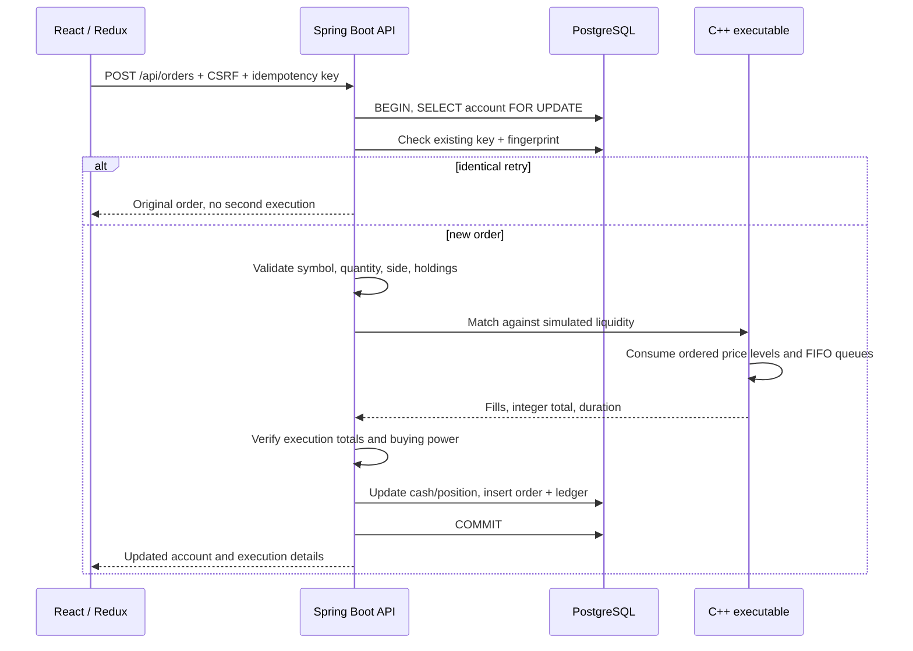
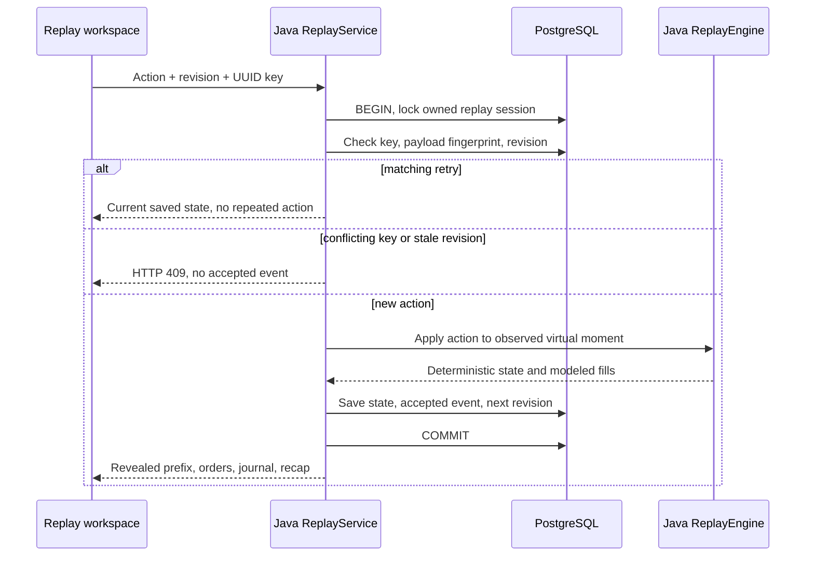

# Architecture and engineering discussion

## Runtime overview

The [README runtime diagram](../README.md#architecture) shows the deployed components. The browser loads the built React application and recorded demo from the same container that serves the Spring Boot API. API calls carry cookies and CSRF headers; the browser never receives database or market-provider credentials. PostgreSQL is the durable authority for identities, accounts, orders, ledger movements, replay sessions/events, and observed portfolio history.

| Component | Responsibility | Source |
| --- | --- | --- |
| React / Redux | Trading workspace, replay controls, decision-tree comparison, demo playback | [`src/`](../src/) |
| Spring request boundary | Origins, CSRF, body limits, API cache policy | [`SecurityConfig.java`](../server/src/main/java/com/lot/SecurityConfig.java) |
| Account service | Row locks, reservations, idempotency, execution validation, ledger writes | [`Accounts.java`](../server/src/main/java/com/lot/Accounts.java) |
| Execution adapter | Bounded subprocess lifetime and strict JSON decoding | [`MatchingEngine.java`](../server/src/main/java/com/lot/MatchingEngine.java) |
| C++ engine | Ordered price levels and FIFO queues for each simulated book | [`matching/main.cpp`](../matching/main.cpp) |
| Replay service / model | Session locking, event persistence, deterministic virtual fills | [`ReplayService.java`](../server/src/main/java/com/lot/ReplayService.java), [`ReplayEngine.java`](../server/src/main/java/com/lot/ReplayEngine.java) |
| Market adapter | Synthetic prices or owner-only provider reads and caching | [`MarketData.java`](../server/src/main/java/com/lot/MarketData.java) |

SMTP is optional: recovery email needs a configured provider; development writes messages to a local mailbox. The private Alpaca adapter reads quotes, bars, and headlines. Neither integration executes real-money orders. The C++ child receives numeric order terms and a reference price, with no credentials or database access. Python and Go are retained only as development compatibility references.

## Ordinary order transaction

## Account consistency

- Money: integer USD cents. Shares: positive whole integers, at most 10,000 per request.
- An order cannot reduce cash below zero, including at database-constraint level.
- Sell requests cannot exceed the current holding; no short selling or margin.
- A unique `(account_id, key)` identifies an order; the canonical input is SHA-256 fingerprinted.
- Failed engine requests and insufficient cash cause transaction rollback, not a partially recorded order.
- Account reset takes the same row lock as order placement, making the operation linearizable per account under PostgreSQL.
- Registered users use opaque random sessions stored as token hashes in PostgreSQL. Guest identifiers are UUIDs in signed HttpOnly, SameSite=Lax cookies. Legacy Django sessions and signed guests remain verifiable with the original signing key.

## Simulated exchange

Quotes are deterministic functions of a 15-second clock bucket. Historical samples form a fictional intraday scenario. Each stock has eight bid and eight ask levels. Java owns quote selection, C++ owns matching, and the browser cannot submit a fill price directly to the ledger.

The matching engine has no account authority. Its publicly accessible POST endpoint only computes an execution against synthetic depth. Calling it never buys shares or changes buying power. All persisted executions pass through Java account transactions.

C++ indexes levels in an ordered map and consumes FIFO entries from the lowest ask for buys or highest bid for sells. Limit orders stop before crossing an unacceptable price. No liquidity gives `cancelled`; some gives `partial`; full quantity gives `filled`. The stateless C++ slice cancels remainders. Java can keep ordinary limit remainders open across slices, reserving cash/shares. A CSRF-protected settlement request evaluates one eligible order, at most once per order per 15-second quote bucket. The browser makes one check per observed quote while the regular workspace is open. Additional fills append OrderMovement rows and update the cumulative order inside the account transaction.

Java invokes the packaged executable with ProcessBuilder and a bounded numeric text protocol, without a shell. At most eight subprocesses run concurrently; capacity waiting has a two-second deadline and execution has a three-second deadline. Output is bounded and independently validated before cash changes. This deliberately preserves the existing stateless simulation. A persistent instrument engine and branching state remain future work, with no throughput claims from an eight-level toy book.

### Execution failure contract

The adapter reads at most 65,537 bytes and rejects output over 65,536 bytes. A successful process must return exactly one non-null JSON object. The C++ executable emits UTF-8; byte-oriented JSON decoding rejects malformed UTF-8 instead of replacing invalid bytes. Empty output, malformed JSON, non-object roots, trailing content, and decoding failures return a safe HTTP 503 response without parser internals. Account execution validation then checks each fill's integer quantity/price, totals, status, requested quantity, and limit price before any cash or position write.

Unavailable binaries, nonzero exits, timeouts, and capacity exhaustion also return HTTP 503. The enclosing account transaction rolls back, including any provisional writes. The caller can retry the same idempotency key after the execution service recovers. A failed attempt does not consume the key as a successful order.

[`MatchingEngineTest`](../server/src/test/java/com/lot/MatchingEngineTest.java) covers wire decoding, including invalid UTF-8. [`scripts/java_faults.py`](../scripts/java_faults.py) substitutes a test executable in a separate local Java process and verifies nine failure modes return 503 with an identical full account response. It then recovers the service, succeeds with the same request key, and retries without another debit. It refuses remote database hosts and runs in CI against disposable PostgreSQL.

## Scaling discussion

For a real exchange-like simulator, partition an order book by instrument, enforce a single writer per partition, maintain price-level queues, and append a durable event log. For account services, replace network calls under database locks with explicit fund reservations and a transactional outbox. Consumers must be idempotent; describe delivery as at-least-once rather than promising distributed exactly-once processing. Measure contention, tail latency, memory per order and crash recovery before choosing more elaborate containers or concurrency mechanisms.

The current deployment is intentionally bounded: a personal portfolio demo packaged as a Java/C++ OCI container with persistent PostgreSQL. It does not claim any production brokerage compliance, throughput targets, or live-market accuracy.

## Relevant interview walkthrough

1. Place a 25-share buy: show execution walking multiple price levels.
2. Explain why integer cents are used and why the displayed estimate can differ from the fill.
3. Retry the same POST/key: show one order and one debit.
4. Submit simultaneous buys: explain account row locks and prevention of overspending.
5. Place a non-crossing limit: show reserved buying power and an open remainder; cancel it to release the reservation. Select IOC to demonstrate immediate cancellation instead.
6. Inspect the transaction boundary and describe the reservation/outbox evolution.

## Owner-only Alpaca feed

`POST /api/connect` verifies a high-entropy owner token using constant-time comparison and creates an opaque server session for a separate persistent account. Java derives its existing UUID from the unchanged token, preserving private account identity. `GET /api/market` resolves this server-side identity before choosing the private adapter. Browser-supplied upstream authorization headers have no effect. Java reads IEX snapshots and selected-symbol bars with server-only credentials, and passes only a validated numeric reference price to C++. The provider never receives brokerage orders.

Synchronized refreshes coalesce within each Java process. Quotes cache 30 seconds, selected bars 60 seconds. Failed refreshes return an error rather than synthetic data. Each provider request has a seven-second timeout; the account lock remains held during quote lookup and bounded matching. Historical chart timestamps identify the latest available regular session, with sparse bars preserved. See README for coverage and cache limitations.

## Replay and learning

Replay executes entirely in Java. It does not spawn the ordinary C++ matcher or depend on the private market feed. Attempt comparison reconstructs recorded states from saved replay events; the decision tree describes observed actions rather than predicting unplayed market outcomes.

ReplaySession holds an independent integer-cent cash/position state, versioned scenario identity, revision, and optional sharing token. ReplayEvent records each accepted action, payload fingerprint, UUID key, and revision. The catalog contains authored scenario descriptions; session responses contain only the observed price/news prefix. Session locking serializes mutations. Equal-key retries do not repeat an action, conflicting payloads and stale revisions return 409, and order IDs derive deterministically from session/request UUIDs for event reconstruction.

Synthetic spread, latency cost, fees, and shared per-side moment liquidity are explicit assumptions. Full spread is divided across buy/sell quotes, latency cost is adverse per fill, and fees round upward to cents. A buy limit conservatively reserves one rounded fee per remaining share, covering repeated partial fills. Finish expires open remainders without liquidating holdings or revealing future prices. The holding benchmark uses the opening mid-price and excludes execution costs. Drawdown uses observed portfolio peaks.

Shared recaps require a finished session and an explicit action. A random revocable token exposes sanitized outcomes without account identity or private session ID. Reasons/reflections are absent unless explicitly included. Guests retain progress in the signed browser workspace; existing guest promotion to a registered account preserves replay ownership.

PortfolioSnapshot stores server-observed marks per account/history epoch/minute. Analytics begin at the first shown observation and compare unchanged initial quantities/cash at later observed prices. Reset rotates the epoch; earlier rows remain. No historical price path is invented. Account cash anchors plus original LedgerEntry and continuation OrderMovement rows support read-only reconciliation. Existing cash/order/ledger columns remain unchanged during additive migrations; the production helper compares their original column sets and row hashes.

Production request logs contain route patterns, generated request IDs, method/status/duration; no bodies, cookies, account IDs, or query strings. Owner-only aggregate learning counters derive from persisted state. Automated verification sessions count as workspaces and must not be described as people or traction. GitHub Actions uses an isolated PostgreSQL 16 service for concurrency checks and runs frontend/Java/C++ and legacy-compatibility checks without production secrets.

## Runtime and migration boundary

Spring Boot 4.1 on Java 21 serves the API and built React assets from one container. Spring Security enforces cookie CSRF and security headers; a request filter enforces mutation origins and a 16 KiB body bound. JDBC transactions and row locks retain the original schema and integer-cent accounting. Flyway owns additive startup migrations, with clean disabled. `Reconciliation` offers an offline read-only audit via `--lot.reconcile=true`.

The final image includes a JRE, C++ binary and static assets. Python and Go entry points are excluded from deployment. Their source remains a migration oracle; `scripts/java_compatibility.py` uses actual Django-generated records, sessions and recovery links against an isolated local database. No Python process handles Java API requests. Spotless formatting and Maven verification run in CI and image builds.
