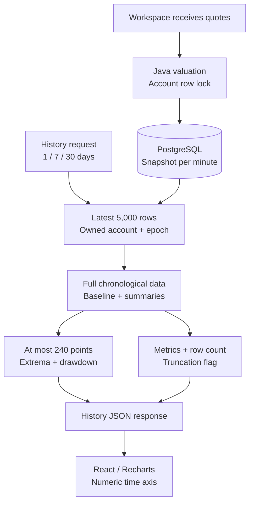

# Observed portfolio history

Lot records an account valuation when the ordinary workspace receives quotes, at most once per observed minute. It does not reconstruct earlier prices or fill gaps. Replay uses a separate virtual timeline and is unaffected by this chart sampler.

## Data flow

## Retention, summaries, and chart selection

These are separate bounds:

| Stage | Contract |
| --- | --- |
| Stored observations | One row per account, tracking epoch, and observed minute; reset rotates the epoch |
| Retained response window | Latest 5,000 rows in the requested 1-, 7-, or 30-day window |
| Summary calculations | All retained rows, before chart selection |
| Chart payload | At most 240 original observations, in chronological order |

`observations` counts the retained rows used for the response, including points not selected for the chart. `limited` is true only when the selected window has more than 5,000 rows; it does not mean that a chart was sampled. `since` is the first retained observation. Empty histories return zero observations and metrics, an empty point list, and no tracking start.

The holding comparison keeps the cash and quantities from the first retained observation and revalues those unchanged quantities at each later observed price. Returns compare the last retained value against the first retained portfolio value. Drawdown measures the largest decline from an earlier observed portfolio peak. All values use integer cents; no average price or synthetic chart point is introduced.

## Sampling algorithm

Histories with 240 or fewer points pass through unchanged. For longer histories:

1. Reserve the first and last observation.
2. Scan the full portfolio series to identify the actual earlier peak and later trough responsible for maximum drawdown. Reserve both points, including when the peak is not the largest value in its bucket.
3. Partition the interior into 59 contiguous buckets by observation index. Within each bucket, select the lowest and highest portfolio value and the lowest and highest holding-comparison value. Ties select the earliest occurrence.
4. Deduplicate selected indices and return their original points in chronological order.

The maximum is `2 endpoints + 2 drawdown points + 59 × 4 extrema = 240`. Overlapping extrema and flat regions produce fewer points. Selection takes linear work in the retained observation count, plus sorting at most 240 indices. It preserves each bucket's extremes and the exact maximum-drawdown pair, but cannot retain every intermediate turn. The full summary metrics remain independent of chart selection.

The browser converts ISO timestamps to numeric milliseconds and plots them on a time scale. A three-hour gap therefore occupies more space than a one-minute gap. Straight lines connect selected observations; they do not imply that Lot measured the intervening values. Sampled histories disclose that returns and drawdown use all retained observations.

## Why this changed

The original every-nth-point selector could miss short moves. A local 5,000-row fixture with a brief 50% portfolio loss reported the correct drawdown but sent a flat portfolio line to the chart. The same fixture now retains that dip and the holding-comparison spike without changing any summary metric. The old stride could also return 479 points for a 479-row history; the new chart budget is a strict upper bound.

## Verification

- [`PortfolioHistoryTest`](../server/src/test/java/com/lot/PortfolioHistoryTest.java) covers empty/small histories, boundary sizes, ordered original points, brief extremes in both series, a non-global peak responsible for maximum drawdown, deterministic selection, immutable inputs, and every bucket's extrema.
- [`scripts/history_sampling.py`](../scripts/history_sampling.py) tests the HTTP/database boundary with 0, 1, 239, 240, 241, 479, 480, 5,000, and 5,001 observations. It compares chart points and metrics against all retained fixture rows and checks account isolation. It refuses remote application/database hosts and deletes its fresh test accounts afterwards.
- GitHub Actions runs both as part of [Quality and accounting](../.github/workflows/quality.yml). No schema migration or external provider is needed.

For the complete runtime, see the [README architecture diagram](../README.md#architecture) and [architecture guide](ARCHITECTURE.md).
